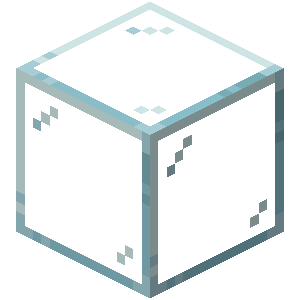

<div align="center">

# Expanded Redstone




[](https://github.com/kole07139/expanded-redstone-pub/issues)


[](https://modrinth.com/mod/expanded-redstone)
[](https://ko-fi.com/kole07139)
[](https://discord.gg/6UadMQKm9n)

## Targets every recent version: from 1.17 up to 26.3


---

</div>

## What this mod fix and add


- **Relays:** A variant of non-conductive blocks (Glass, stair, slab, hopper, azalea, ecc...) which **bypass the hardcoded downward-block transmission** for redstone signals. 

A relay simply allows the redstone dust signal to pass downward, while remaining a non-conductive block. They are crafted with 1 central amethyst shard bounded by 4 of your non-conductive block in a cross shape.

***→ Fun fact:** now the longest name in Minecraft will be: "Relay Waxed Weathered Cut Copper Stairs"*


- **Redstone Lantern:** A simple redstone variant of the lantern, inspired to the block models of [Redstone Lantern](https://modrinth.com/mod/redstonelantern) Mod. It is more powerful compared to the Redstone Torch, as the Lantern variant will strongly power (A Redstone Torch always strong powers the upper block) every neighbor block, exception made for the hanging block. Also, the Redstone Lantern burnout has been doubled in time, resulting not in 8 clocks but 16 clocks. 

This mod also adds two optional QoL resource packs to better identify, whether in the inventory or in the block model, the difference between a Relay and a normal block.

### → Feel free to suggest more features as a GitHub issue!

---

### Vanilla


### New Relays


For redstoners, it might actually be useful to know whats the code behind the downward propagation in relays. This is the only thing this mod affects in the redstone code:
```java
/** Adds relay blocks to the vertical-diode decision without changing vanilla blocks. */

@Mixin(RedstoneWireEvaluator.class)

// Assumes priority 1000 and a Minecraft version higher than 1.21.2
// Before 1.21.2 the wire signal is computed in RedStoneWireBlock class instead of in RedstoneWireEvaluator: same relay logic though

public abstract class RedstoneWireEvaluatorMixin {
@Shadow protected abstract int getWireSignal(BlockPos pos, BlockState state);

    @Inject(method = "getIncomingWireSignal", at = @At("HEAD"), cancellable = true)
    private void expandedredstone$allowRelayDownward(Level level, BlockPos pos,
                                                   CallbackInfoReturnable<Integer> cir) {
        int i = 0;
        for(Direction direction : Direction.Plane.HORIZONTAL) {
            BlockPos neighborPos = pos.relative(direction);
            BlockState neighborState = level.getBlockState(neighborPos);
            i = Math.max(i, this.getWireSignal(neighborPos, neighborState));
            BlockPos abovePos = pos.above();
            // isRelay OR added within the isRedsoneConductor check, since a below pos can access power if such neighbor block is a relay
            if ((neighborState.isRedstoneConductor(level, neighborPos) || expandedredstone$isRelay(neighborState)) && !level.getBlockState(abovePos).isRedstoneConductor(level, abovePos)) {
                BlockPos aboveNeighborPos = neighborPos.above();
                i = Math.max(i, this.getWireSignal(aboveNeighborPos, level.getBlockState(aboveNeighborPos)));
            }
            if (!neighborState.isRedstoneConductor(level, neighborPos)) { // else removal, since now it is a dual logic
                BlockPos belowNeighborPos = neighborPos.below();
                i = Math.max(i, this.getWireSignal(belowNeighborPos, level.getBlockState(belowNeighborPos)));
            }
        }

        cir.setReturnValue(Math.max(0, i - 1));
    }

    @Unique
    private static boolean expandedredstone$isRelay(BlockState state) {
        return state.getBlock() instanceof Relay relay && relay.isRelay(state);
    }
}

/*
        For comparison, this is how vanilla computes the signal instead:
        
     protected int getIncomingWireSignal(Level level, BlockPos blockPos) {
        int i = 0;

        for(Direction direction : Plane.HORIZONTAL) {
            BlockPos blockPos2 = blockPos.relative(direction);
            BlockState blockState = level.getBlockState(blockPos2);
            i = Math.max(i, this.getWireSignal(blockPos2, blockState));
            BlockPos blockPos3 = blockPos.above();
            if (blockState.isRedstoneConductor(level, blockPos2) && !level.getBlockState(blockPos3).isRedstoneConductor(level, blockPos3)) {
                BlockPos blockPos4 = blockPos2.above();
                i = Math.max(i, this.getWireSignal(blockPos4, level.getBlockState(blockPos4)));
            } else if (!blockState.isRedstoneConductor(level, blockPos2)) {
                BlockPos blockPos4 = blockPos2.below();
                i = Math.max(i, this.getWireSignal(blockPos4, level.getBlockState(blockPos4)));
            }
        }

        return Math.max(0, i - 1);
    }
        
 */
```

---

### Redstone Lantern

It sends strong signal to the 5 neighbors around it (6 except the hanged block) and acts as a way more powerful redstone torch.

Compared to the redstone torch, the burnout time is doubled, resulting in 16 clocks instead of 8. Here some demos:


Principal functionalities of the Redstone Lantern are also shown here if redstoners want to inspect the behavior of the block:

```java
    //? if >=1.21.2 {
    protected Orientation randomOrientation(Level level) {
    return ExperimentalRedstoneUtils.initialOrientation(level, null, Direction.UP);
    }
    //? }

    public boolean isSignalSource(BlockState blockState) {
        return blockState.getValue(LIT);
    }

    public int getSignal(BlockState blockState, BlockGetter blockGetter, BlockPos blockPos, Direction direction) {
        if(blockState.getValue(LIT)){
            if(blockState.getValue(HANGING)){
                return Direction.DOWN != direction ? 15 : 0;
            }else{
                return Direction.UP != direction ? 15 : 0;
            }
        }else{
            return 0;
        }
    }
    public int getDirectSignal(BlockState blockState, BlockGetter blockGetter, BlockPos blockPos, Direction direction) {
        if(blockState.getValue(LIT)){
            if(blockState.getValue(HANGING)){
                return Direction.DOWN != direction ? 15 : 0;
            }else{
                return Direction.UP != direction ? 15 : 0;
            }
        }else{
            return 0;
        }
    }

    protected boolean hasNeighborSignal(Level world, BlockPos pos, BlockState state) {
        return shouldUnpower(state, world, pos);
    }

    protected boolean shouldUnpower(BlockState state, Level level, BlockPos pos) {
        if(state.getValue(HANGING)) return level.hasSignal(pos.above(), Direction.UP);
        else return level.hasSignal(pos.below(), Direction.DOWN);
    }
```

---

Feedback and bug reports are greatly appreciated! **[Bug tracker](https://github.com/kole07139/expanded-redstone-pub/issues).**
Joining my Discord is also strongly encouraged! **[Discord server](https://discord.gg/6UadMQKm9n)**.

---
## 🐛 Bug reports, issues or suggestions

As Expanded Redstone is in an early development stage, you may find bugs. Please report reproducible issues on GitHub and use the Discord server for general questions and discussion.

### Please, use the GitHub issue report for suggestions and enhancements too!

---
## Credits

Thanks to:

- [Redstone Lantern](https://modrinth.com/mod/redstonelantern), for textures, models and block states of the Redstone Lantern. The code of that mod was **not** taken nor seen though, the behavior is an original work of this mod.


---

<div align="center">

# My Other Projects!

If you enjoy [Expanded Redstone], you may enjoy my other projects:


</div>

### [Defixus Anti-Cheat] - (1.21.11 - 26.4)
A complete well shaped and live anti-cheat for the newer minecraft versions. Modpack oriented, casual servers, huge communities.

### [Builders Freecam] - (1.17 - 26.4)
A complete well shaped fork of [Freecam], which prevents Hack-like features such as traveling on "solid" blocks and lava, and cave-peeking.

### [Just Redstone Waterlog] - (1.14 - 26.4)
This Mod/Plugin extends all Bedrock Edition **Redstone** components waterloggable blocks into Java Edition.

### [Just Bedrock Waterlog] WIP - (1.14 - 26.4)
This projects extends **all Bedrock** Edition waterloggable blocks into Java Edition. Comes with a config too!

### [ViaAlert (ViaVersion Addon)] - (1.21.11 - 26.4)
It lets you see when people join into your Fabric server which version are they using, and which client they are from.

### [Cobalt Age] - (1.21.11 - 26.4)
This is a more shaped technical mods, which adds a complete new energy system called **Cobalt Energy System**, which works parallelly to Redstone, being different in the fact that it is not compatible with redstone signals and that it is waterloggable, and even more features, such as an up to 60 power strength.

---

<details>
<summary> 📃 Terms of Use and Attribution | Usage of Expanded Redstone in Modpacks (only Modrinth allowed) </summary>


_**Expanded Redstone is proprietary software by Kole07139 distributed under All Rights Reserved (ARR). Only and only downloadable on the website https://modrinth.com/mod/expanded-redstone. There are unofficial and illegal builds on the web that are not affiliated with me, and they may contain viruses. Every illegal redistribution will be removed due to Copyright and sued.**_

_Copyright © 2026 kole07139. All Rights Reserved. License URL:_ https://github.com/kole07139/expanded-redstone-pub/blob/main/LICENSE


_All original source code, compiled binaries, assets, documentation, branding, and other original components of Expanded Redstone are protected by intellectual property laws. You cannot republish the work, and you can mention it only and only providing original credit to the Author and link back to the official modrinth page: https://modrinth.com/mod/expanded-redstone without exploiting the download links, that **must** happen only through the Modrinth Platform_.

_Downloading Expanded Redstone does **not** grant ownership, redistribution rights, modification rights, commercial exploitation rights, or permission to sublicense any part of the project._

### Monetization & Commercial Use & Publishing — STRICTLY PROHIBITED

_**Any commercial exploitation of Expanded Redstone (code or assets) is expressly prohibited without prior, explicit, written authorization from the copyright holder.**_

_This restriction includes, but is not limited to:_

- _**Paid modpacks:** Selling, licensing, paywalling, or otherwise commercially exploiting modpacks that incorporate Expanded Redstone or parts of it (including assets)._
- _**Advertising revenue:** Generating revenue from Expanded Redstone distributions through advertisements, sponsored download links, URL shorteners, affiliate programs, or third-party advertising platforms._

_and more..._

_The fact that Expanded Redstone is available free of charge does not authorize anyone to commercially exploit it, and the same applies to its assets._

### Modpacks, Redistribution & Third-Party Hosting

_Unless independently authorized under applicable platform terms or expressly permitted in writing by the copyright holder:_

- _Reuploading, mirroring, redistributing, repackaging, or hosting Expanded Redstone binaries or its assets is prohibited._
- _Bundling Expanded Redstone (or its assets) directly into third-party launchers, standalone distributions, commercial modpacks, or installation packages is prohibited._
- _Distributing modified, renamed, repackaged, or unofficial versions of Expanded Redstone or its assets is prohibited._
- _Replacing official download links with third-party download services is prohibited._
- _Claiming authorship, official endorsement, partnership, or affiliation with Expanded Redstone is prohibited._
- _Using the Expanded Redstone name, logo, or branding in ways suggesting an official release or endorsement is prohibited._

_**MODPACKS: The only allowed method to use Expanded Redstone in your Modrinth Modpacks (other platforms are prohibited), is by linking back, in your Mod's Description, directly to Expanded Redstone Modrinth page (https://modrinth.com/mod/expanded-redstone)**._

_**EXPANDED REDSTONE DOWNLOAD: The allowed method to download Expanded Redstone is only through the Modrinth platform (Modpacks that subjects to the above statement or the Expanded Redstone Modrinth page: https://modrinth.com/mod/expanded-redstone), anything else will be removed due to Copyright violation.**_

### Permitted Use

_Subject to the applicable distribution platform's terms, users may download, install, configure, and run official Expanded Redstone releases for personal, non-commercial purposes._

_Non-commercial server administrators may use official releases without requesting individual authorization, provided they do not redistribute unauthorized copies or commercially exploit Expanded Redstone._

_For ordinary gameplay and server administration, linking players to the official project page is encouraged._

---

</details>

**Expanded Redstone is free to download and use as it is. It is not free to redistribute, resell, modify for distribution, republish its jars or sponsor it without written permission of the author, or use it in modpacks without properly tagging it in your modpack changelog and description (modrinth only), or commercially exploit, or use assets from its public repository or from its jar in any case. Read the terms of use and the license before proceeding doing anything. On doubt write the author on Discord. Do not do any of the above without a proper, formal, written permission from the author, Kole07139.**

<sub>**Copyright © 2026 kole07139. All Rights Reserved.**</sub>


[Freecam]: https://modrinth.com/mod/freecam


[Builders Freecam]: https://modrinth.com/mod/buildersfreecam
[Defixus Anti-Cheat]: https://modrinth.com/mod/defixus
[ViaAlert (ViaVersion Addon)]: https://modrinth.com/mod/vva
[Just Redstone Waterlog]: https://modrinth.com/mod/jrw
[Just Bedrock Waterlog]: https://modrinth.com/mod/jrw
[Cobalt Age]: https://modrinth.com/mod/cobalt-age
[Expanded Redstone]: https://modrinth.com/mod/expanded-redstone

[Wiki]: https://github.com/kole07139/defixus-public/wiki
